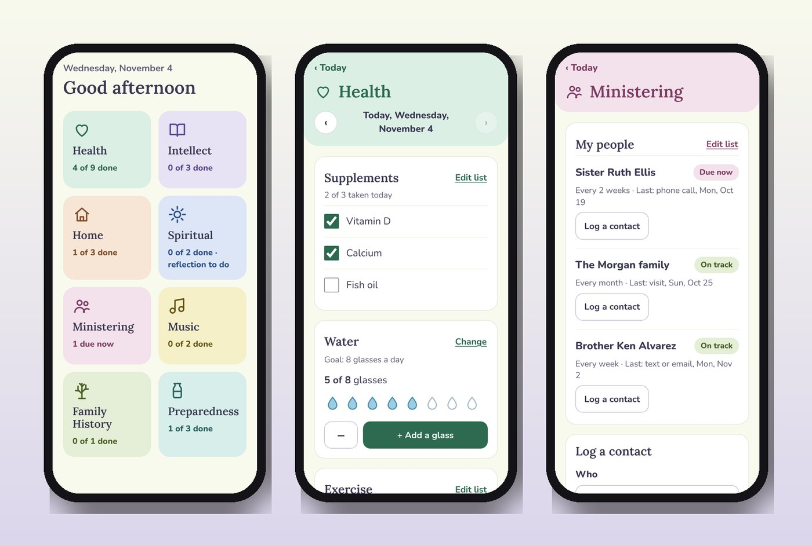
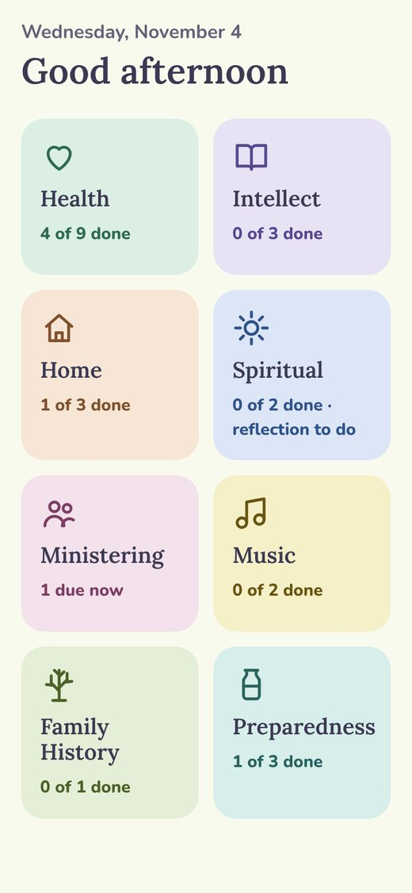
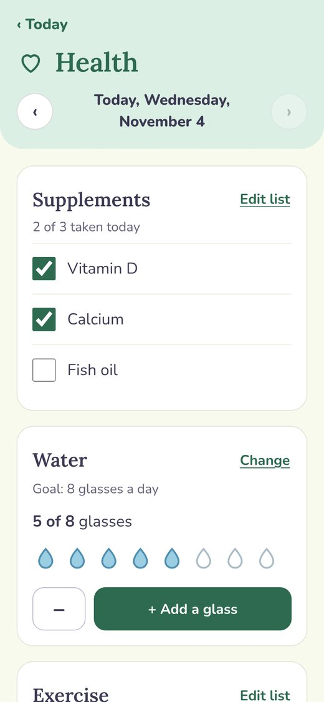
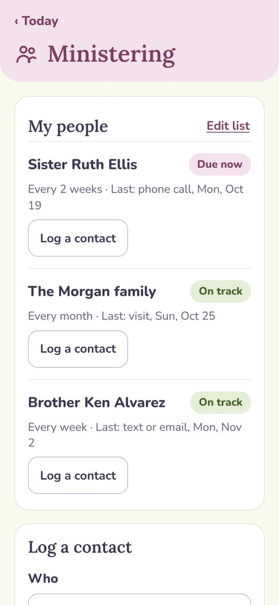

<h1 align="center">Habits: Grandma (Wendy's Goals)</h1>

<em>Big buttons, gentle colors, and every goal in one place.</em>

<a href="https://joshp523.github.io/wendys-app/"><b>▶ Open the app</b></a>

Wendy's Goals is a goal tracker made for Grandma. Each area of life gets its own colored tile, and every goal is one tap away: a glass of water, a walk, twenty minutes of piano.

## What she can track

- **Health:** water, steps, exercise and supplements.
- **Intellect:** reading, Spanish and more.
- **Home:** decluttering and projects, a few times a week.
- **Spiritual:** scripture study and a daily reflection on Christlike attributes.
- **Ministering:** the people she looks after, with gentle "due now" reminders.
- **Music, Family History and Preparedness.**

Goals repeat until she changes them, and anything can be daily, weekly or monthly.

**Just visiting?** The sign-in screen has a *Take a tour* button, so anyone can try every screen with made-up goals. Nothing is saved, and Wendy's real goals stay private.

<table><tr><td align="center" valign="top"> Today</td><td align="center" valign="top"> Health</td><td align="center" valign="top"> Ministering</td></tr></table>
## Why it's worth a look

- **Cool:** Pastel tiles, iris and lily-of-the-valley artwork, and text big enough to read without glasses.
- **Innovative:** It was designed around one grandmother's actual goals, and it doubles as a gift: a tour mode lets friends try it safely.
- **Impressive:** Daily, weekly and monthly goals, a reflection journal and a ministering tracker, all private to her and synced between her iPhone and iPad.
- **Useful:** Tap, done. No menus to learn, nothing to set up, and it remembers everything.

---

### On your phone
Open the link in Safari (iPhone/iPad) or Chrome (Android), then choose **Share → Add to Home Screen**. It gets its own icon and opens full-screen, just like an app from the store.

### More apps by Josh Riley
[The Riley Rag](https://joshp523.github.io/RileyRag/) · [QuipRash](https://joshp523.github.io/Quip-game-app/) · [Word Games](https://joshp523.github.io/Word-Games/) · [Russian Verbs](https://joshp523.github.io/russian/) · [Riley Rangers](https://joshp523.github.io/Rangers-app/) · [Habits: Josh](https://joshp523.github.io/daily-discipline/) · [Habits: Meishe](https://joshp523.github.io/Habit-tracker-app-Meishe/) · [Writing](https://joshp523.github.io/writing-app/)

Built by Josh Riley. Setup notes for whoever maintains it are in [SETUP.md](SETUP.md).
